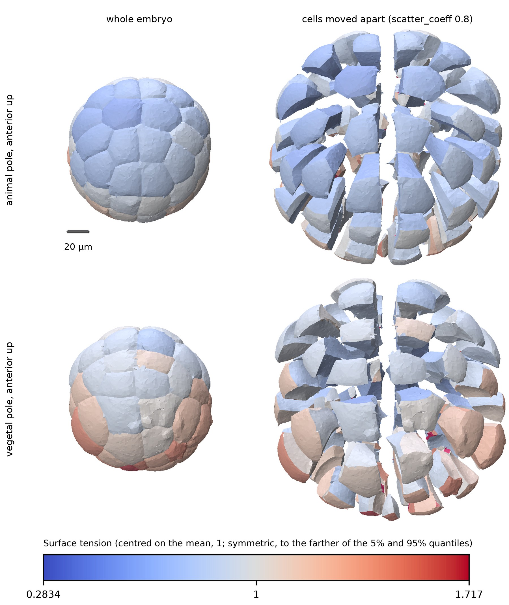
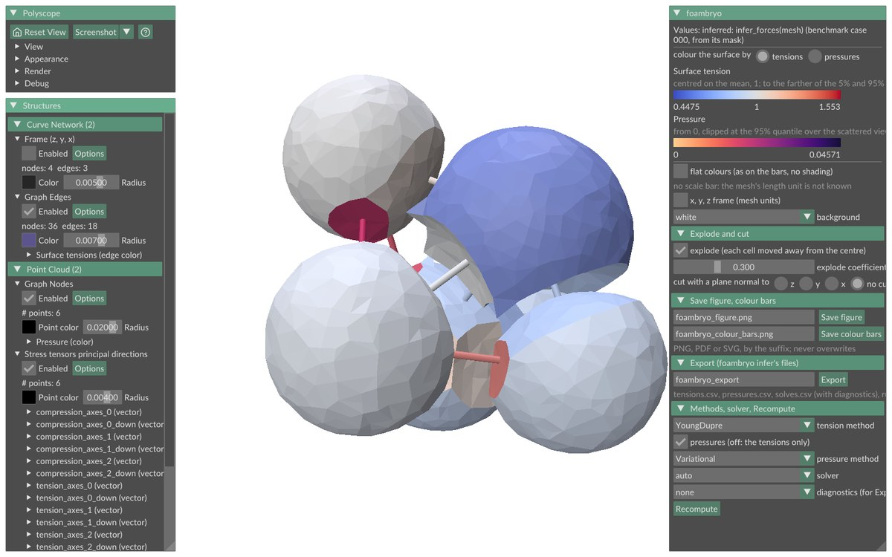
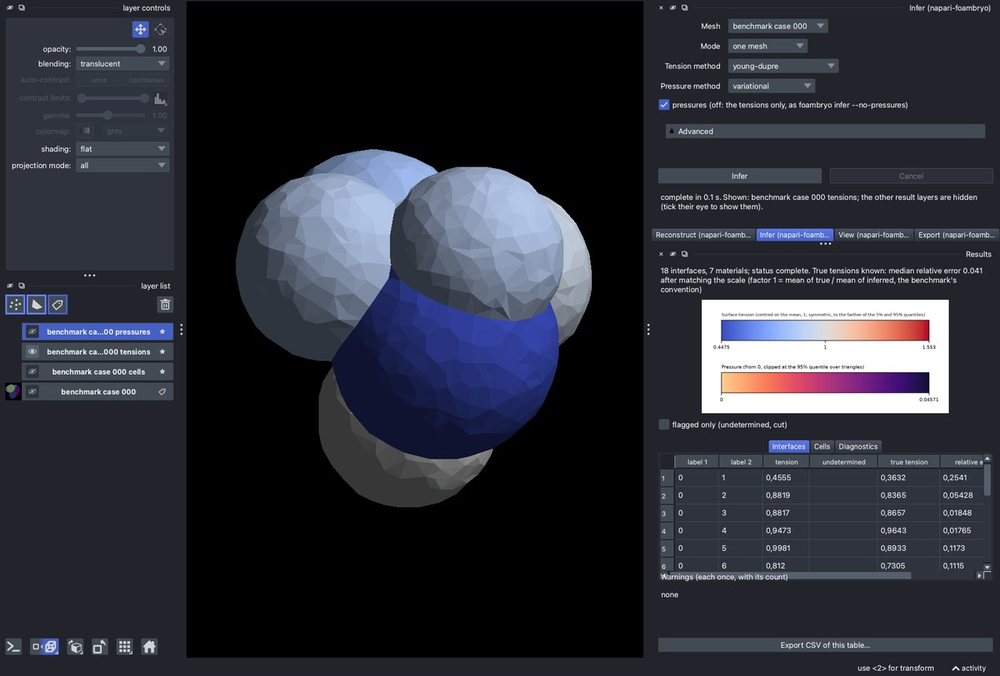
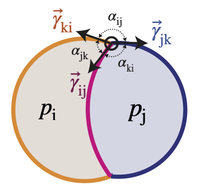
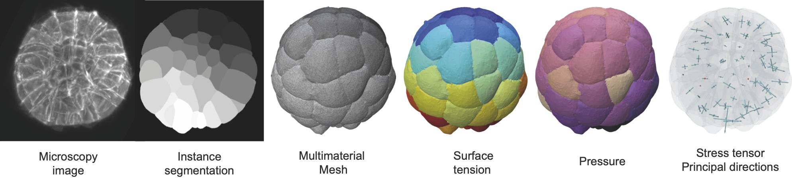
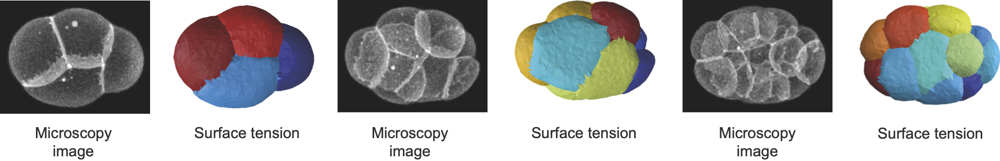
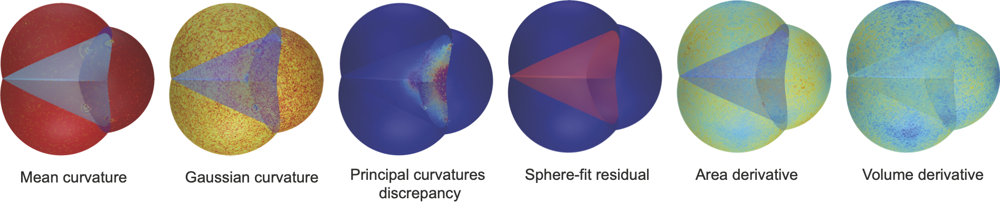

# foambryo

[![GPL-3.0-or-later][gpl-shield]][gpl] [](https://doi.org/10.5281/zenodo.8184850)

**foambryo** infers the relative surface tensions and cell pressures of foam-like cell aggregates (early embryos, tissues, organoids) from the geometry of their cells, in 3D and in 2D.



*A 64-cell* Phallusia mammillata *embryo seen from its animal pole (top) and vegetal pole (bottom), anterior up, bilateral symmetry plane vertical: relative surface tensions inferred by foambryo, the whole embryo (left) and its cells moved apart (right). Seen from opposite sides, the embryo's left and right swap between the rows.*

*Segmentation: Astec-Pm10, time point 10 (Lemaire 2020, [doi:10.6084/m9.figshare.8235485](https://doi.org/10.6084/m9.figshare.8235485), CC BY 4.0; Guignard et al., Science 2020); mesh by delaunay-watershed-3d, tensions by `infer_tensions`, drawn by foambryo's viewer; script: `Images_github_repo/make_the_readme_figure_of_a_64_cell_embryo.py`.*

It was developed by Sacha Ichbiah during his PhD in [Turlier Lab](https://www.turlierlab.com), and is maintained by Matthieu Perez and Hervé Turlier. For support, please open an issue. If you use it in your work, in 3D or in 2D, please cite both articles: Ichbiah S., Delbary F., McDougall A., Dumollard R., Turlier H. *Embryo mechanics cartography: inference of 3D force atlases from fluorescence microscopy.* Nature Methods **20**(12), 1989–1999 (2023), [doi:10.1038/s41592-023-02084-7](https://doi.org/10.1038/s41592-023-02084-7); and Yamamoto K., Ichbiah S., Perez M., Borrego-Pinto J., Delbary F., Goehring N. W., Northrop P., Turlier H., Charras G. *Spatiotemporal mapping of the contractile and adhesive forces sculpting early C. elegans embryos.* Developmental Cell **61**(6), 1273–1288.e4 (2026), [doi:10.1016/j.devcel.2026.04.013](https://doi.org/10.1016/j.devcel.2026.04.013).

Since 0.8.0 foambryo also infers tensions, pressures and stresses in 2D, from a 2-D segmentation mask or mesh, with the same functions and the same command line: the input decides the dimension. The 2D inference is provisional.

The documentation (user guide, examples, API reference) is in [`docs/`][docs]; the full list of changes is in the [CHANGELOG][changelog], and what can mislead you in the [release notes][notes].

## What's new in 0.8.0

Install foambryo and delaunay-watershed 0.8.0 together: `pip install foambryo` installs both.

- **Two-dimensional tissues (provisional).** `dcel_mesh_from_segmentation_mask`, `infer_tensions`, `infer_pressures`, `infer_forces`, the command line and the viewers take 2-D masks and meshes; a 2-D mesh is a `PlanarMesh`. Junction angles are read on circular arcs by default (`angle_reading="arc"`), with `"chord"` and `"fitted_tangent"` offered; pressures come from Laplace's law on the fitted circles; junctions on the image border are excluded, and lenses whose angles cannot separate their two tensions are refused with `nan` and a warning. On synthetic equilibrium foams the arc reading lowers the tension error by 0.068 and the pressure error by 0.091 of the RMS pressure against the chord ([BENCHMARKS.md](BENCHMARKS.md)). See the [user guide's page on 2D tissues][two-dimensional].
- **An opt-in global fit in 2D**, `infer_forces_by_equilibrium_tiling(mesh, mask)`: one equilibrium tiling of circular arcs fitted to the mask, more accurate than the arc reading on synthetic foams, but it still refuses some crops whole; not for confined tissues.
- **Which numbers to trust for compressed cells.** Pressures, and the stresses built on them, are measurements only for cells deformed by nothing but their own tensions and pressures. In an embryo inside its eggshell the cells are compressed against the shell, and an interface's curvature follows Laplace's law, and its tangent Young–Dupré, only close to the junctions: there, read the tensions with the chord (`angle_reading="chord"` in 2D; not the arc reading nor the global fit), leave out the pressures, and draw the **deviatoric stress**, new in 2D and 3D (`plot_force_inference(..., stress="deviatoric")`), which is then the contribution of the cortical tensions, not the cell's total stress anisotropy (the shell's contact forces also act on the cells).
- **Curvature and stress in 2D**: `compute_curvature_interfaces` and `compute_curvature_vertices_cotan` take 2-D meshes; the viewer draws each cell's stress.
- **One orientation rule in 2D and 3D**: each mesh element is the positively oriented boundary of its first label; foambryo measures a 2-D mesh's orientation on input, so meshes in the former orientation give the same results.
- **foambryo no longer depends on torch**: the `autodiff` extra is removed; the inference never used it. Python 3.12 or later.
- **Two worked examples on real 2D images** (4-cell *C. elegans* embryos with and without eggshell, CC BY-SA 4.0), in `Examples/`.

## What's new in 0.7.1

Install foambryo and delaunay-watershed-3d 0.7.1 together.

- **Media besides the exterior.** A lumen that delaunay-watershed-3d 0.7.1 meshes as its own region is solved like a cell (its own interface tensions and pressure) but reported and drawn as a medium; `--media` names one in a mesh made elsewhere. `pressures.csv` then gets a `region_kind` column.
- **`foambryo view` draws the tissue, not its mirror image.** Every view and saved figure of 0.7.0 was mirrored; no number was affected.
- **The benchmark numbers are measured on delaunay-watershed-3d 0.7.1's meshes**, which differ slightly from 0.7.0's; this package's inference is unchanged. Two user-guide statements were corrected: the second-order angle reading's numbers were those of meshes without junction relocation, and what its 0.5.0 repair changed.
- **The test suites run on Linux x86-64 CI** as well as on macOS.

## What's new in 0.7.0

0.7.0 is the first release on PyPI since 0.5.1; it includes everything prepared for 0.6.0, which was not published. Install foambryo and delaunay-watershed-3d 0.7.0 together.

- **Cropped tissues.** Where the image cuts the tissue, the mesh's *crop faces* are kept out of every equation, and the pressures of the cut cells are `nan` instead of wrong numbers.
- **Masks with anisotropic voxels.** Give the voxel size (`spacing=(dz, dy, dx)`) and the mask is resampled to cubic voxels before meshing, which was measured to be more accurate than meshing the native grid.
- **Large tissues.** Sparse solves above 2 000 unknowns, a `solver` option, a table of every linear solve, and an estimate of the reconstruction's time and memory before it runs.
- **The normalisation is exact.** The returned tensions now have exactly the requested mean (`mean_tension`); tension ratios are unchanged, but the overall scale of the tensions (and so of the pressures) changes by one factor per mesh, by up to 1.4 % for `YoungDupre`.
- **Seed ensembles.** `infer_tensions_over_seeds` reconstructs a mask at several dither seeds and averages the tensions; their spread is a lower bound on the error.
- **A command line**, `foambryo mesh`, `infer`, `infer-over-seeds` and `view`, for batch runs.
- **The viewer** draws its colour bars, a length scale bar, explodes and cuts the tissue, saves figures, exports the values, and can start from a mask. Tensions are coloured blue–grey–red around the mean tension; pressures with a trimmed `magma`; undetermined values in green.
- **A napari plugin**, [napari-foambryo](https://github.com/VirtualEmbryo/napari-foambryo), released with 0.7.0 as its version 0.1.0: `pip install "napari[all]" napari-foambryo`.
- **Fixes that change results**: meshes of cells that touch the image border (their border triangles were wound the wrong way, in delaunay-watershed-3d); `ForceBalanceMAP` no longer depends on the mesh's length unit; cells that no Laplace equation determines get `nan`; `Cotan`, `InvCotan`, `Lami` and `LogLami` leave out flat junction lines (wedges of exactly 0 or 180 degrees) instead of breaking; the first-order error bars include a term they missed and are documented as a lower bound.

## Installation

foambryo needs Python 3.12 or later. Install it from PyPI, in a virtual environment:

```shell
pip install foambryo                 # the library
pip install "foambryo[viewing]"      # and the Polyscope viewer (Polyscope, matplotlib)
pip install "foambryo[cli]"          # and TIFF masks for the foambryo command (tifffile)
pip install "foambryo[viewing,cli]"  # both
```

Every dependency, delaunay-watershed (its 3D and 2D meshers) included, is installed by pip. The napari plugin is installed with `pip install "napari[all]" napari-foambryo`. For development, clone the repository and `pip install -e "./foambryo[viewing,cli]"`. The test suites run on Linux x86-64 and on macOS on Apple silicon (arm64), with Python 3.12 and 3.13, with the newest and the lowest supported versions of the dependencies; other systems are expected to work but are not tested.

foambryo starts from a **segmentation mask**: a 3-D array of integer labels, one per cell, 0 for the medium, axis 0 being z, or a 2-D one, axis 0 being y. Make it with any segmentation tool (a watershed, [Cellpose](https://www.cellpose.org), …); its quality and resolution set the precision of the result.

## Quick start

**In Python**: reconstruct the mesh, infer the tensions and pressures, look at them.

```py
import tifffile                                # pip install "foambryo[viewing,cli]"
from foambryo import dcel_mesh_from_segmentation_mask, infer_forces
from foambryo.viewing import plot_force_inference

mask = tifffile.imread("segmentation.tif")                               # axis 0 is z
mesh = dcel_mesh_from_segmentation_mask(mask, spacing=(1.0, 0.5, 0.5))  # voxel size (dz, dy, dx), in um
tensions, pressures = infer_forces(mesh)       # {(label_1, label_2): tension}, {label: pressure}
plot_force_inference(mesh, tensions, pressures, length_unit="um")
```

**In 2D**: the same calls on a 2-D mask (square pixels only); the default angle reading is the arc.

```py
mask = tifffile.imread("segmentation_2d.tif")                       # axis 0 is y
mesh = dcel_mesh_from_segmentation_mask(mask, spacing=(0.25, 0.25))  # a PlanarMesh, in um
tensions, pressures = infer_forces(mesh)       # pressures: only for a tissue deformed by its own forces
plot_force_inference(mesh, tensions, pressures, image=tifffile.imread("membranes_2d.tif"))
```

**On the command line**: the same, from files, with the same numbers.

```shell
foambryo mesh segmentation.tif --spacing 1.0 0.5 0.5 -o tissue.rec
foambryo infer tissue.rec -o results
foambryo view tissue.rec --results results
```

**In napari**, with the napari-foambryo plugin: *File › Open Sample › foambryo › Benchmark case 000*, then *Plugins › foambryo › Reconstruct*, *Infer* and *Results* (see the plugin's README).

More: the [examples][examples] (two-dimensional tissues, with and without an eggshell; anisotropic voxels, cropped tissues, seed ensembles, large tissues, the command line, the viewer) and the [introductory notebook](https://github.com/VirtualEmbryo/foambryo/blob/v0.8.0/Examples/Example.ipynb).

## Viewers

| Polyscope (`foambryo[viewing]`) | napari (`napari-foambryo`) |
|---|---|
|  |  |

*Benchmark case 000 (a simulated 6-cell aggregate), reconstructed from its mask and inferred with the defaults; the tensions on the surface, with the same colour bar in both viewers.*


*The same case in napari-foambryo, from the mask to the exported files: Reconstruct, Infer, Results, the pressures, View's explode slider, Export.*

Both viewers draw what the library returns, with the library's colours, so a value has the same colour in both. The Polyscope window (`foambryo view`, or `plot_force_inference` and the other `plot_*` functions) shows the colour bars and a length scale bar, explodes and cuts the tissue, changes the methods and recomputes, saves figures and exports the values; `foambryo view MASK --spacing DZ DY DX` starts from the mask and reconstructs it in the window. See the [viewers guide][viewers].

## Physical model

We consider a tissue made of cells *i*, which minimise, under conservation of their volumes, an energy $\mathcal{E}=\sum_{i<j}\gamma_{ij}A_{ij}$, where $A_{ij}$ is the area of the interface between cells *i* and *j*.



Two laws follow:

- **Young-Dupré**: $\gamma_{ij}\vec t_{ij} + \gamma_{ik}\vec t_{ik} + \gamma_{jk}\vec t_{jk} = \vec 0$ along each junction line between cells *i*, *j* and *k*, where $\vec t_{ij}$ is the unit vector tangent to the interface between *i* and *j*, normal to the line and pointing away from it;
- **Laplace**: $p_j - p_i = 2 \gamma_{ij} H_{ij}$, where $H_{ij}$ is the mean curvature of that interface.

Angles fix only the ratios of the tensions, and the Laplace law only the differences of the pressures. So the tensions are **normalised**: their mean is `mean_tension` (1 by default), exactly, in each connected piece of the junction graph. The pressures are relative to the medium's, `base_pressure` (0 by default), in units of tension per length unit of the mesh. An interface with no junction line (a closed surface) has no measurable tension: it is `nan`, never a number.

foambryo offers thirteen tension methods (`YoungDupre`, the default, reads the contact angles; others invert a global operator) and three pressure methods (`Variational`, the default, `Laplace`, `WeightedLaplace`); see the [methods guide][methods]. A short [methods note][methods-note] says what each method computes (the unknowns and conventions, the angle-based and force-balance methods, the pressures, the diagnostics and error bars) and how to read the results.

## In practice

- **Cropped tissues.** Where a cell reaches the image box, the mesh closes it with *crop faces*, which are not contact with the medium. Every tension method keeps them out of its equations; the pressures of the cells they cut are `nan`, with a `CutCellPressureWarning`; the Laplace pressure methods refuse a cropped mesh. A tissue that really ends on an image face (a coverslip): `physical_image_faces=("axis0_low",)`. See [cropped tissues][cropped].
- **Anisotropic voxels.** Give the voxel size. Measured on simulated tissues whose cells are as small as real ones, down-sampled along z, against the same tissues meshed at full resolution: resampling to cubic voxels first costs +0.83, +0.71 and +1.17 degrees of contact-angle error at an anisotropy of 5/3, 2 and 3, against +1.38, +1.97 and +4.10 for meshing the native grid (measured on dw3d 0.7.0's meshes, before 0.8.0 pads thin margins of medium on the native grid, and not measured again, because some of these runs need 8 to 40 GiB of memory; [BENCHMARKS.md](BENCHMARKS.md)). Above 3 nothing was measured, and a warning says so. The cost is that of a mask acquired at the short spacing. See [anisotropic voxels][aniso].
- **Large tissues.** `foambryo.reconstruction_cost` estimates the reconstruction's time and memory before it runs (a 1 866-cell tissue resampled to cubic voxels: 13.5 minutes and 38 GiB on the machine measured). The tension and pressure systems are solved sparsely from 2 000 unknowns (`solver="auto"`); `diagnostics=True` returns a record of every solve. On a 1 866-cell tissue the sparse solve took 9 s and 1 GiB where the dense one took 6 to 9 minutes and 14–18 GiB, and they agree to 1.5e-11 (measured on a mesh from dw3d's 0.6.0 code, not on 0.7.1's, which has 93 099 points where 0.7.0's has 93 097; not measured again: one run needs about 31 GiB). See [large tissues][large].
- **Seed ensembles.** delaunay-watershed-3d dithers its points with a seed; another seed gives slightly different tensions. `infer_tensions_over_seeds(mask)` averages eight reconstructions: it lowered the median tension error from 0.152 (a single seed, on average) to 0.123 on synthetic tissues with cells of real size (meshes from dw3d's 0.6.0 code, never published and part of 0.7.0; not measured again on 0.7.1's meshes). **The seed spread is a lower bound on the error, not an error bar**: a single seed's ±1 SD interval held the true tension for about half of the interfaces. Interfaces found by fewer than half of the seeds are flagged. `combine="angles"` is experimental: on synthetic masks degraded by a smooth random warp of about one voxel, it lost its advantage over the default on tissues of 90 and 165 cells while keeping it on small aggregates. See [seed ensembles][seeds].
- **Error bars.** `infer_tensions_with_uncertainty` gives intervals with their measured calibration; none is a calibrated error bar on a reconstructed mesh, and the first-order one of `YoungDupre` is a lower bound. It stops at about 1 300 cells of real size, where its dense diagnostics outgrow scipy, and says so at once.

## Command line

```shell
foambryo mesh MASK --spacing DZ DY DX -o MESH.rec      # reconstruct (TIFF needs foambryo[cli])
foambryo infer MESH.rec -o OUTDIR                      # tensions.csv, pressures.csv, run.json
foambryo infer MESH.rec -o OUTDIR --no-pressures       # the tensions only
foambryo infer MESH.rec -o OUTDIR --diagnostics basic  # and solves.csv, one row per linear solve
foambryo infer-over-seeds MASK --spacing DZ DY DX -o OUTDIR   # a seed ensemble
foambryo view MESH.rec --results OUTDIR                # the Polyscope window
```

Every default is the library's: `foambryo infer` gives the numbers of `infer_forces(dcel_mesh_from_file(MESH))`, bit for bit, and `run.json` records the versions, the options and the equivalent Python call. The spacing has no default, because a wrong spacing changes every angle without any other sign. Every option, file, column, exit code and message is in the [command-line specification][cli].

## Biological examples

### *P. mammillata* early embryo

*Phallusia mammillata* is a solitary marine tunicate of the ascidian class, known for its stereotypical development. Its embryo develops freely, so its tensions, pressures and stresses can all be inferred. Segmentation data from [Guignard, L., Fiúza, U. et al.](https://www.science.org/doi/10.1126/science.aar5663)



### *C. elegans* early embryo, in 3D and in 2D

The *Caenorhabditis elegans* embryo develops within a shell of unknown shape and mechanics, so its pressures are not accessible, but the Young-Dupré law still gives the surface tensions. Segmentation data from [Cao, J., Guan, G., Ho, V.W.S. et al.](https://doi.org/10.1038/s41467-020-19863-x)



In 2D, the examples `Examples/two_dimensional_tissue_without_eggshell.ipynb` and `Examples/choosing_an_angle_reading_inside_an_eggshell.ipynb` infer the tensions of 4-cell embryos imaged in one plane, with and without their eggshell, and show which angle reading, pressures and stresses each allows. Data: Yamamoto et al., Developmental Cell 2026, Zenodo [doi:10.5281/zenodo.19627642](https://doi.org/10.5281/zenodo.19627642), CC BY-SA 4.0 (three frames of each embryo in `Examples/data/`).

### Scalar quantities on the surfaces

With `scalar_quantities=True`, the viewer also draws the Gaussian curvature (angle defect), the mean curvature (cotangent formula), the vertex area and volume derivatives, the difference between the principal curvatures and the residual of the best sphere fit.



## Repository layout

The development repository also holds the project's research record (working notes, exploratory scripts and their results), for provenance. It is not part of the distribution: `pip install` does not ship it, and nothing under `foambryo` imports from it.

## Credits, contact, citation

If you use this tool, in 3D or in 2D, please cite both articles: Ichbiah S., Delbary F., McDougall A., Dumollard R., Turlier H. *Embryo mechanics cartography: inference of 3D force atlases from fluorescence microscopy.* Nature Methods **20**(12), 1989–1999 (2023), [doi:10.1038/s41592-023-02084-7](https://doi.org/10.1038/s41592-023-02084-7); and Yamamoto K., Ichbiah S., Perez M., Borrego-Pinto J., Delbary F., Goehring N. W., Northrop P., Turlier H., Charras G. *Spatiotemporal mapping of the contractile and adhesive forces sculpting early C. elegans embryos.* Developmental Cell **61**(6), 1273–1288.e4 (2026), [doi:10.1016/j.devcel.2026.04.013](https://doi.org/10.1016/j.devcel.2026.04.013). For the opt-in global fit in 2D, please also cite Noll N., Streichan S. J., Shraiman B. I., Phys. Rev. X **10**, 011072 (2020), [doi:10.1103/PhysRevX.10.011072](https://doi.org/10.1103/PhysRevX.10.011072). Contact Matthieu Perez and Hervé Turlier for practical questions and applications.

Recent work on dw3d and foambryo is part of a collaboration with Alejandro Aguilera Castrejon (Janelia Research Campus, Howard Hughes Medical Institute). We thank him and his Janelia colleagues Adam L. Taylor, Wenhong Li and Francesco Roncato. Adam L. Taylor found the border-triangle winding defect fixed in 0.6.0 and pointed us to the seed-extraction and dense tension-solve bottlenecks on large tissues.

```bibtex
@article{Ichbiah2023,
  author    = {Ichbiah, Sacha and Delbary, Fabrice and McDougall, Alex and Dumollard, R{\'e}mi and Turlier, Herv{\'e}},
  title     = {Embryo mechanics cartography: inference of {3D} force atlases from fluorescence microscopy},
  journal   = {Nature Methods},
  volume    = {20},
  number    = {12},
  pages     = {1989--1999},
  year      = {2023},
  month     = dec,
  publisher = {Springer Science and Business Media LLC},
  issn      = {1548-7105},
  doi       = {10.1038/s41592-023-02084-7},
  url       = {https://doi.org/10.1038/s41592-023-02084-7}
}
```

```bibtex
@article{Yamamoto2026,
  author    = {Yamamoto, Kazunori and Ichbiah, Sacha and Perez, Matthieu and Borrego-Pinto, Joana and Delbary, Fabrice and Goehring, Nathan W. and Northrop, Paul and Turlier, Herv{\'e} and Charras, Guillaume},
  title     = {Spatiotemporal mapping of the contractile and adhesive forces sculpting early {C. elegans} embryos},
  journal   = {Developmental Cell},
  volume    = {61},
  number    = {6},
  pages     = {1273--1288.e4},
  year      = {2026},
  doi       = {10.1016/j.devcel.2026.04.013},
  url       = {https://doi.org/10.1016/j.devcel.2026.04.013}
}
```

## Licence

foambryo is free software: you can redistribute it and modify it under the terms of the [GNU General Public License][gpl], version 3 or (at your option) any later version (SPDX `GPL-3.0-or-later`); the text is in `License`. This covers versions 0.5.0 and later; earlier releases keep the licence they were published under (CC BY-NC-SA 4.0).

[![GPLv3][gpl-image]][gpl]

[gpl]: https://www.gnu.org/licenses/gpl-3.0.html
[gpl-image]: https://www.gnu.org/graphics/gplv3-127x51.png
[gpl-shield]: https://img.shields.io/badge/License-GPLv3-blue.svg
[docs]: https://github.com/VirtualEmbryo/foambryo/blob/v0.8.0/docs/index.md
[changelog]: https://github.com/VirtualEmbryo/foambryo/blob/v0.8.0/CHANGELOG.md
[notes]: https://github.com/VirtualEmbryo/foambryo/blob/v0.8.0/RELEASE_NOTES.md
[two-dimensional]: https://github.com/VirtualEmbryo/foambryo/blob/v0.8.0/docs/user-guide/two-dimensional-tissues.md
[examples]: https://github.com/VirtualEmbryo/foambryo/blob/v0.8.0/docs/examples/index.md
[methods]: https://github.com/VirtualEmbryo/foambryo/blob/v0.8.0/docs/user-guide/methods.md
[methods-note]: https://github.com/VirtualEmbryo/foambryo/blob/v0.8.0/docs/methods-note.md
[viewers]: https://github.com/VirtualEmbryo/foambryo/blob/v0.8.0/docs/user-guide/viewers.md
[cropped]: https://github.com/VirtualEmbryo/foambryo/blob/v0.8.0/docs/user-guide/cropped-tissues.md
[aniso]: https://github.com/VirtualEmbryo/foambryo/blob/v0.8.0/docs/user-guide/anisotropic-voxels.md
[large]: https://github.com/VirtualEmbryo/foambryo/blob/v0.8.0/docs/user-guide/large-tissues.md
[seeds]: https://github.com/VirtualEmbryo/foambryo/blob/v0.8.0/docs/user-guide/seed-ensembles.md
[cli]: https://github.com/VirtualEmbryo/foambryo/blob/v0.8.0/docs/command_line_specification.md
