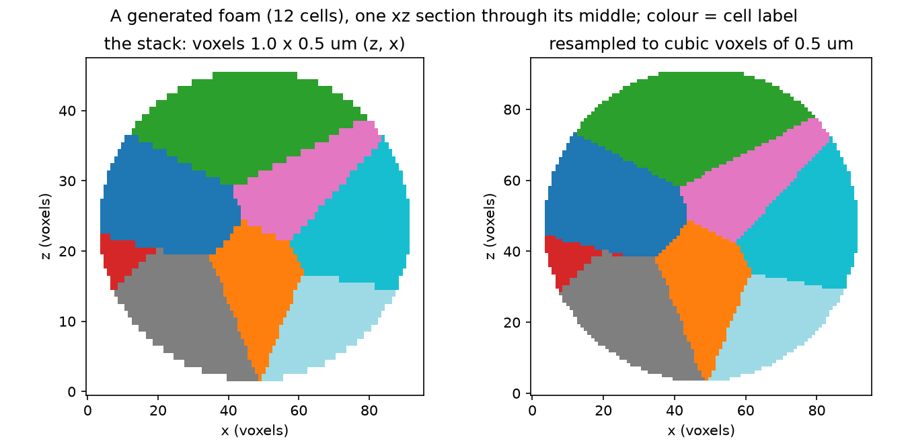

# Anisotropic voxels

A mask whose voxels are longer along z: give the spacing, and the mask is resampled to cubic voxels first.

A microscope stack usually has a z step larger than its pixel size. This example builds a foam of Voronoi cells on cubic voxels of 0.5 um, keeps every second z slice (voxels of 1.0 x 0.5 x 0.5 um, an anisotropy of 2), and shows what giving the spacing changes:

* the estimate of the reconstruction's time and memory counts the voxels **after** resampling (twice as many);
* `dcel_mesh_from_segmentation_mask(mask, spacing=(1.0, 0.5, 0.5))` resamples the mask to cubic voxels of 0.5 um by shape-based interpolation, meshes it, and returns the mesh **in um**; `mesh.source_spacing` records the spacing, and so does the `.rec` file that `reconstruct_mask` writes (the `foambryo mesh` route);
* the cells' volumes, in um^3, agree with their voxel counts times the voxel volume;
* without the spacing, the same stack is meshed in voxel units and squashed along z: every volume is half what it should be, and every contact angle is read on a deformed tissue.

The accuracy gain of resampling first is measured, not shown here: on 12 simulated tissues at equilibrium with cells as small as those of real tissues, down-sampled along z, the contact-angle error grew by +0.83, +0.71 and +1.17 degrees at an anisotropy of 5/3, 2 and 3 when the mask is resampled first, against +1.38, +1.97 and +4.10 when the native grid is meshed and the mesh scaled afterwards (each against the same tissue meshed at full resolution; measured on dw3d 0.7.0's meshes, not measured again for 0.7.1, whose meshes differ slightly, because some of these runs need 8 to 40 GiB of memory; see `BENCHMARKS.md`). One small example cannot show a difference of a degree: its own seed-to-seed spread is larger.

    pip install "foambryo[viewing]"          # matplotlib, for the figure
    python anisotropic_voxels.py             # under a minute; writes ./anisotropic-voxels-output/

The script: [`Examples/anisotropic_voxels.py`](https://github.com/VirtualEmbryo/foambryo/blob/v0.7.0/Examples/anisotropic_voxels.py). It needs only foambryo (and matplotlib, from `foambryo[viewing]`, for its figure); it generates its own tissue.



*One xz section of the generated stack (voxels 1.0 x 0.5 um) and of its resampling to cubic voxels of 0.5 um; colour = cell label.*

## Output of one run

On macOS 14 (Apple M3 Max), Python 3.12; times vary with the machine.

```text
the stack: shape (48, 96, 96), 12 cells, spacing (1.0, 0.5, 0.5) um
voxels handed to the reconstruction: 8.85e+05 (the stack has 4.42e+05); estimated 0.3 s and 0.32 GiB (fitted on tissues of 2 to 1 866 cells)
with spacing: mesh in um, extent (z, y, x) = [46.5 47.  46.5], source_spacing (1.0, 0.5, 0.5)
  cell volume / (voxels x voxel volume): median 0.964
without spacing: mesh in voxels, extent (z, y, x) = [47.  95.  91.2]: the tissue is squashed along z;
  cell volume / (voxels x true voxel volume): median 0.481
anisotropic-voxels-output/stack.rec: 602 points, 1423 triangles, 12 cells (0 cut by the image boundary); recorded {'coordinate_frame': 'physical', 'spacing': (1.0, 0.5, 0.5), 'spacing_unit': 'um', 'resampling': 'shape'}
  read back: source_spacing (1.0, 0.5, 0.5)
tensions of 49 interfaces, mean 1.000 (normalised to 1)
figure: anisotropic-voxels-output/stack_and_its_resampling.png
```

## The script

```python
--8<-- "Examples/anisotropic_voxels.py"
```
