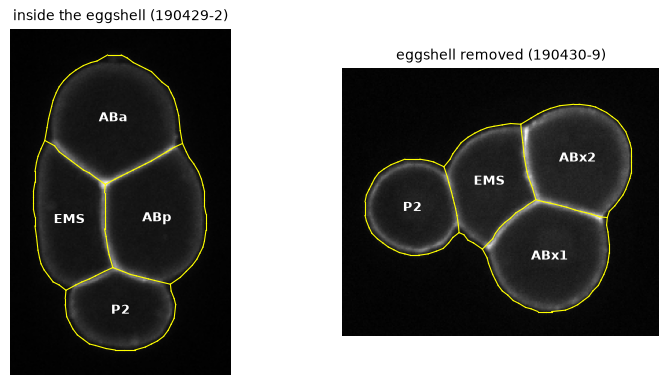
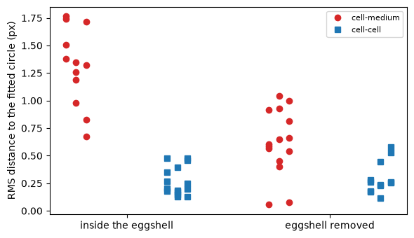
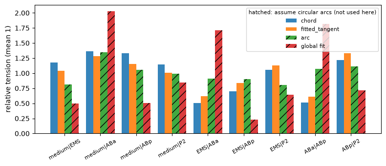
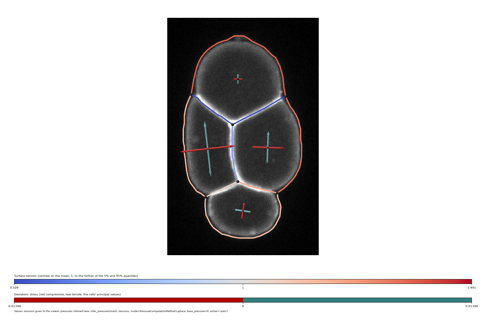

# Choosing an angle reading inside an eggshell

In a 4-cell *C. elegans* embryo inside its eggshell, the cells are compressed against the shell. The shell's contact forces act on the cells where they touch it, so an interface's curvature follows Laplace's law, and its tangent obeys Young–Dupré, only close to the junctions; further along, the interface takes the shape the shell imposes. For such compressed cells the notebook reads the junction angles with the **chord** (`angle_reading="chord"`) and shows `"fitted_tangent"`, the other reading local to the junctions, as a check; it computes **no pressures**, which would be read from curvatures the shell sets and would not make sense; it shows the arc reading and the opt-in global fit **only to explain why they are not used** here; and it draws the **deviatoric stress**, the contribution of the cortical tensions, which under confinement is not the cell's total stress anisotropy (the shell's contact forces also act on the cells).

Every comparison below is measured on **one embryo per condition** (one inside its eggshell, one whose eggshell was removed, three frames each): it shows which assumption fails inside an eggshell, not how accurate any reading is.

    pip install "foambryo[viewing]"
    cd Examples
    jupyter notebook choosing_an_angle_reading_inside_an_eggshell.ipynb

The notebook: [`Examples/choosing_an_angle_reading_inside_an_eggshell.ipynb`](https://github.com/VirtualEmbryo/foambryo/blob/v0.8.0/Examples/choosing_an_angle_reading_inside_an_eggshell.ipynb), saved with its outputs. It runs in a few seconds; the viewer's figure needs a display.

**Data.** Three frames each of embryos 190429-2 (inside its eggshell; cells ABa, ABp, EMS and P2) and 190430-9 (eggshell removed; ABx1, ABx2, EMS and P2) of Yamamoto et al., *Developmental Cell* 2026 (Zenodo [doi:10.5281/zenodo.19627642](https://doi.org/10.5281/zenodo.19627642)), CC BY-SA 4.0, in `Examples/data/`. If you use foambryo, please cite both the Nature Methods 2023 and the Developmental Cell 2026 articles (see the [home page](../index.md)).

*Frame 1 (normalised time 0.49) of embryo 190429-2 inside its eggshell (left) and of embryo 190430-9 without it (right): the membrane image, the 2D mesh's interfaces (yellow) and the cells' names; the code of foambryo 0.8.0 and delaunay-watershed-2d 0.8.0, at their defaults.*

## The tensions, read with the chord

| interface | chord | fitted tangent (check) |
|---|---|---|
| medium–EMS | 1.174 | 1.039 |
| medium–ABa | 1.364 | 1.280 |
| medium–ABp | 1.330 | 1.157 |
| medium–P2 | 1.145 | 1.006 |
| EMS–ABa | 0.506 | 0.617 |
| EMS–ABp | 0.699 | 0.838 |
| EMS–P2 | 1.053 | 1.127 |
| ABa–ABp | 0.513 | 0.607 |
| ABp–P2 | 1.217 | 1.329 |

*Relative tensions (mean 1) of embryo 190429-2, frame 1; the two local readings differ by 0.118 on average.*

## Why not the arc reading or the global fit

*Root-mean-square distance (pixels) of each interface's mesh vertices to the circle `interface_arcs` fits to it, for the three frames of each embryo (the three columns of points in each group): cell–medium interfaces (red circles) and cell–cell interfaces (blue squares). Inside the eggshell the cell–medium interfaces depart from a circle by 0.67 to 1.76 px, against 0.06 to 1.04 px without it; the cell–cell interfaces stay within 0.13 to 0.48 px and 0.12 to 0.58 px. One embryo per condition.*

*The tension (relative, mean 1) of each interface of embryo 190429-2, frame 1, read by `"chord"` (used), `"fitted_tangent"` (the check), and, hatched, the arc reading and the global fit, which assume circular interfaces; the code of foambryo 0.8.0 and delaunay-watershed-2d 0.8.0, at their defaults. Mean absolute difference from the chord: 0.118 for the fitted tangent, 0.258 for the arc reading, 0.706 for the global fit, whose tensions spread from 0.228 to 2.031 against 0.506 to 1.364 for the chord.*

The arc reading, the Laplace pressures and the global fit all assume circular interfaces. A circle fitted to an interface flattened against the shell gives a wrong tangent at its ends and a wrong curvature: the arc reading reads wrong junction angles at the cell–medium interfaces, the Laplace pressures read wrong curvatures, and the global fit, which forces every interface onto a circle and every cell to obey Laplace's law, has no way to represent the shell's push.

## The deviatoric stress: the cortical tensions' contribution

*Embryo 190429-2, frame 1, in foambryo's 2D window: each interface coloured by its tension read by `"chord"`, and each cell's deviatoric stress $\sigma - \frac{\operatorname{tr}\sigma}{2} I$ at its centroid (principal axes scaled by their values; compression red, tension teal), drawn by `plot_force_inference(mesh, tensions, image=image, stress="deviatoric")`. The cells are not coloured by pressure and the bars are the tension bar and the deviatoric stress's; the footer's pressures are those the viewer infers for its full-stress option, not drawn and not measurements here. The glyphs are the contribution of the cortical tensions; the shell's contact forces, which also act on the cells, are not in them. the code of foambryo 0.8.0 and delaunay-watershed-2d 0.8.0, at their defaults.*

## In short

| tissue | junction angles | tensions | pressures and full stress | deviatoric stress |
|---|---|---|---|---|
| free, near equilibrium (no eggshell, no substrate) | `"arc"` (default); the global fit, opt-in | yes | yes | the anisotropic part of the cell's stress |
| compressed or confined (eggshell, substrate) | `"chord"`; `"fitted_tangent"` as a check | yes, read near the junctions | no | the cortical tensions' contribution only |

On the command line: `foambryo infer MESH --angle-reading chord --no-pressures`, and `foambryo view MESH --angle-reading chord --stress deviatoric`. No real image has known tensions: this example shows which assumption fails inside an eggshell and that the choice of reading matters there, not which local reading is closest to the truth. For a free embryo, whether the arc or the chord is closer to the truth on real masks is an open question (see the [free-tissue example](two-dimensional-tissue.md)). See [two-dimensional tissues](../user-guide/two-dimensional-tissues.md).
