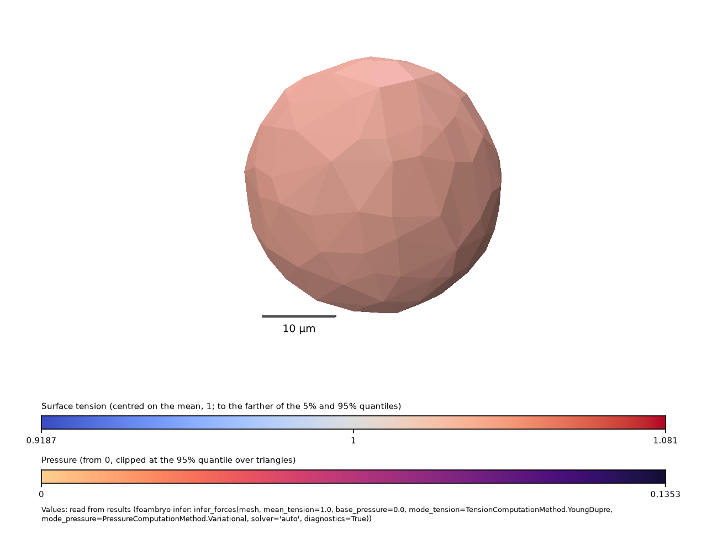

# The command line, from a mask to the figures

[`Examples/command_line_example.sh`](https://github.com/VirtualEmbryo/foambryo/blob/v0.7.0/Examples/command_line_example.sh) runs every sub-command of `foambryo` on a doublet at equilibrium (two equal spheres split by a plane), whose three tensions are all 1 and whose pressures are 2/R = 0.133 per um: `foambryo mesh` (from a `.npz` that records its voxel size, and from a `.npy` stack with `--spacing`), `foambryo infer` (with `--diagnostics basic`, and `--no-pressures`), `foambryo view` (`--colour-bars` without a window, `--figure` with one) and `foambryo infer-over-seeds`.

    pip install "foambryo[viewing]"
    sh command_line_example.sh



*`foambryo view doublet.rec --results results --figure results/figure.png --no-show`: the doublet's tensions and pressures (shown by the tensions), with the colour bars.*

## Output of one run

```text
mask, for information (nothing is changed): 2 cells; 0 touch the image box (cut cells); 0 in several pieces; 0 pieces of medium enclosed by the tissue; 0 smaller than 5% of the median cell (4771.4 voxels)
wrote doublet.rec: 310 points, 630 triangles, 2 cells (0 cut by the image boundary)
mask, for information (nothing is changed): 2 cells; 0 touch the image box (cut cells); 0 in several pieces; 0 pieces of medium enclosed by the tissue; 0 smaller than 5% of the median cell (2385.7 voxels)
wrote doublet_from_the_stack.rec: 304 points, 625 triangles, 2 cells (0 cut by the image boundary)
wrote results/tensions.csv
wrote results/pressures.csv
wrote results/solves.csv
wrote results/run.json
wrote results-tensions-only/tensions.csv
wrote results-tensions-only/run.json
wrote results/colour_bars.png: tension 0.918712 to 1.08129, pressure 0 to 0.135339
wrote results/figure.png
wrote results-over-seeds/tensions.csv
wrote results-over-seeds/tensions_per_seed.csv
wrote results-over-seeds/run.json
label_1,label_2,tension
0,1,1.0365525429421798
0,2,1.0578284456386409
1,2,0.9056190114191799
label,pressure
0,0.0
1,0.13027858293102407
2,0.13533901454340083
index,system,solver,n_rows,n_unknowns,rank,residual_norm,condition_number,condition_number_source,seconds,lsqr_istop,lsqr_iterations,spectrum_seconds,spectrum_note,n_singular_values
0,YoungDupre tension system,dense lstsq,4,3,3,6.628683812140618e-16,1.2754666092060924,singular values of dense lstsq (2-norm),0.00010391700016043615,,,,,3
1,Variational pressure system,dense inv,2,2,2,0.0,1.393096799960001,SVD of the cells x cells matrix (2-norm; computed for diagnostics only),0.002161542000976624,,,,,2
label_1,label_2,tension
0,1,1.1035926439473065
0,2,1.1080629833257924
1,2,0.788344372726901
label_1,label_2,tension,tension_seed_sd,n_seeds_found,found_by_fewer_than_half_the_seeds
0,1,1.068962417273275,0.029247815548050605,8,false
0,2,1.0764760355509257,0.021868788532474117,8,false
1,2,0.854561547175799,0.04443751792585566,8,false
```

## The script

```sh
--8<-- "Examples/command_line_example.sh"
```

Every option, file, column, exit code and message: the [command-line specification](../command_line_specification.md).
