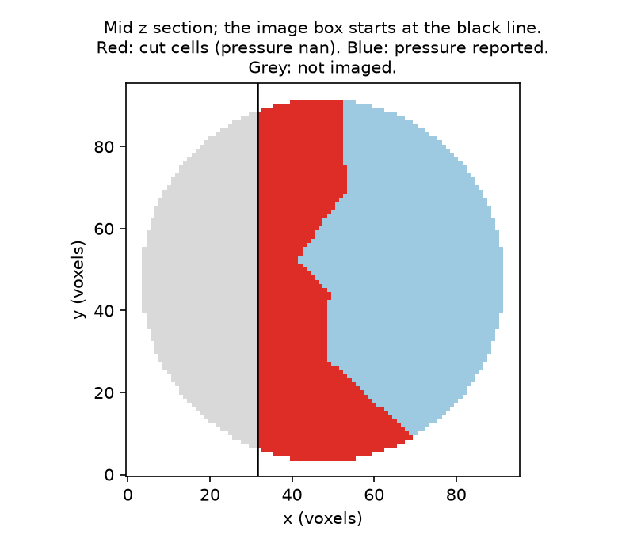

# Cropped tissue

A tissue the image cuts: crop faces, cut cells, `nan` pressures, and a pressure method that refuses.

When a cell of the mask reaches a face of the image box, the mesh closes it with triangles on that face. They are not contact with the medium: the tissue goes on beyond the image. delaunay-watershed-3d marks them as **crop faces**, and foambryo keeps them out of every equation:

* the tensions are inferred from the junctions the image shows; an interface made only of crop faces is absent;
* the pressures of the **cut cells** (the cells the crop cuts) are `nan`, with a `CutCellPressureWarning`, because part of their surface and volume was not observed;
* the Laplace pressure methods have no formulation for crop faces and raise `ValueError` on a cropped mesh (`PressureComputationMethod.has_crop_face_formulation` says which methods accept one: only `Variational`).

This example builds a foam of Voronoi cells, cuts away a third of it along x, and runs the inference on the cut mask. The foam is not at mechanical equilibrium: its tensions show the workflow, not the method's accuracy. (On 433 plane crops of 47 simulated tissues at equilibrium, the tensions of the interfaces next to the crop had 14 %, 33 % and 39 % error with 10 %, 25 % and 40 % of the tissue cut away when crop faces were read as medium contact, and 10 %, 9 % and 13 % with crop faces kept out.)

If the tissue really ends on a face of the image (for example on a coverslip), declare that face physical: `dcel_mesh_from_segmentation_mask(mask, physical_image_faces=("axis2_low",))`; its triangles are then contact with the medium.

    pip install "foambryo[viewing]"          # matplotlib, for the figure
    python cropped_tissue.py                 # under a minute; writes ./cropped-tissue-output/

The script: [`Examples/cropped_tissue.py`](https://github.com/VirtualEmbryo/foambryo/blob/v0.7.0/Examples/cropped_tissue.py). It needs only foambryo (and matplotlib, from `foambryo[viewing]`, for its figure); it generates its own tissue.



*The middle z section of the generated foam: the image box starts at the black line; the cut cells, whose pressures are nan, in red.*

## Output of one run

On macOS 14 (Apple M3 Max), Python 3.12; times vary with the machine.

```text
the cut mask: shape (96, 96, 64), 12 cells
222 crop faces of 1402 triangles; cut cells (2, 3, 4, 5, 6, 7, 9); interfaces made only of crop faces: ()
47 tensions; any crop interface among them: False
pressures: 5 cells reported, 7 nan (the cut cells)
  Variational      has a formulation for crop faces: True
  Laplace          has a formulation for crop faces: False
  WeightedLaplace  has a formulation for crop faces: False
Laplace on a cropped mesh refuses: PressureComputationMethod.Laplace has no formulation for crop faces (the curvature of an interface that the crop cuts is read partly on the crop); use PressureComputationMethod.Variational
with the cut face declared physical (a coverslip): 0 crop faces, cut cells ()
figure: cropped-tissue-output/cut_cells_in_a_section.png
```

## The script

```python
--8<-- "Examples/cropped_tissue.py"
```
