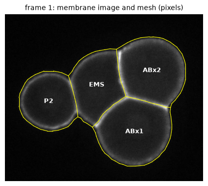
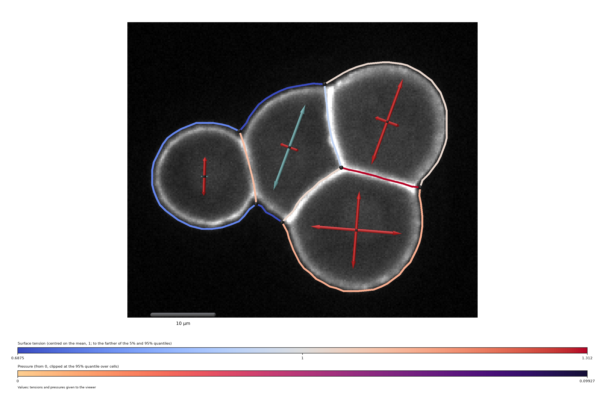
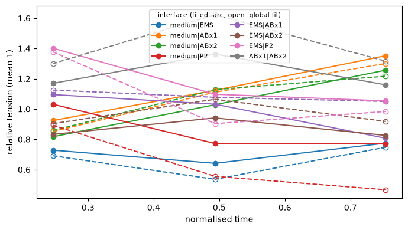

# A free 2D tissue: mask → mesh → tensions, pressures and stresses

A 4-cell *C. elegans* embryo whose eggshell was removed, imaged in one plane: its cells are deformed by their own tensions and pressures only, so the arc reading (the 2D default), the Laplace pressures, the full stress and the opt-in global fit all apply. The notebook meshes the segmentation mask, infers the tensions and pressures, draws them with each cell's stress over the membrane image, compares the arc reading with the global fit and with the chord, and follows the tensions over three frames.

    pip install "foambryo[viewing]"     # Polyscope and matplotlib
    cd Examples                         # the notebook reads data/ from there
    jupyter notebook two_dimensional_tissue_without_eggshell.ipynb

The notebook: [`Examples/two_dimensional_tissue_without_eggshell.ipynb`](https://github.com/VirtualEmbryo/foambryo/blob/v0.8.0/Examples/two_dimensional_tissue_without_eggshell.ipynb), saved with its outputs. It runs in a few seconds; the viewer's figure needs a display.

**Data.** Three frames of embryo 190430-9 of Yamamoto et al., *Developmental Cell* 2026 (Zenodo [doi:10.5281/zenodo.19627642](https://doi.org/10.5281/zenodo.19627642)), CC BY-SA 4.0, in `Examples/data/`; its README says how they were made. Cells: EMS, P2, and the two AB daughters, ABx1 and ABx2. If you use foambryo, please cite both the Nature Methods 2023 and the Developmental Cell 2026 articles (see the [home page](../index.md)).

## The mask and its mesh

*The membrane image of frame 1 (normalised time 0.49) of embryo 190430-9, the 2D mesh's interfaces over it (yellow) and each cell's name at its area centroid; mesh by `dcel_mesh_from_segmentation_mask` at `min_distance` 4 pixels; the code of foambryo 0.8.0 and delaunay-watershed-2d 0.8.0, at their defaults.*

## Tensions, pressures and stresses

The arc reading's tensions (relative, mean 1) and the Laplace pressures (per micrometre, the medium at 0) of the same frame:

| interface | arc | global fit | chord |
|---|---|---|---|
| medium–EMS | 0.642 | 0.536 | 1.181 |
| medium–ABx1 | 1.124 | 1.111 | 1.215 |
| medium–ABx2 | 1.029 | 1.128 | 1.273 |
| medium–P2 | 0.773 | 0.556 | 1.293 |
| EMS–ABx1 | 1.032 | 1.077 | 0.529 |
| EMS–ABx2 | 0.941 | 1.064 | 0.576 |
| EMS–P2 | 1.097 | 0.904 | 1.406 |
| ABx1–ABx2 | 1.363 | 1.623 | 0.528 |

Pressures (per µm), arc reading and global fit: EMS 0.058 and 0.047, ABx1 0.100 and 0.100, ABx2 0.094 and 0.104, P2 0.088 and 0.063. The global fit found a valid tiling and refused nothing on this frame.

*Frame 1 of embryo 190430-9 in foambryo's 2D window (`plot_force_inference(..., save_figure=..., show=False)`): each interface coloured by its tension (arc reading; colour bar centred on the mean, 1), the junctions in black, and each cell's mean stress tensor at its centroid, its principal axes scaled by their values (compression red, tension teal); the pressure colour bar is drawn but the cells are not filled in this first view; scale bar 10 µm; the code of foambryo 0.8.0 and delaunay-watershed-2d 0.8.0, at their defaults.*

## Three frames

*The tension of each interface (colour) on the three frames of the file, read by the arc reading (filled markers, solid lines) and by the global fit (open markers, dashed lines); the code of foambryo 0.8.0 and delaunay-watershed-2d 0.8.0, at their defaults. Three frames show the workflow; they are not a time series analysis.*

## What it shows, and what it does not

- The arc reading and the global fit both assume circular interfaces and a tissue deformed by its own forces only; that is why they are offered for a free embryo. Both give relative tensions (mean 1) and pressures relative to the medium; neither gives absolute values.
- **An open question.** No real image has known tensions. The readings' accuracy (BENCHMARKS.md, *Two-dimensional tissues*) was measured on synthetic foams; on this real mask (one embryo, one frame) the chord gives three of the four cell–cell interfaces 0.39 to 0.61 times the tension the arc reading gives them. Which reading is closer to the truth on real free tissues is not known.
- The mask's cell–medium boundaries lie about 1 to 2 px outside the membrane, which moves the junction angles at the cell–medium interfaces.
- In an embryo inside its eggshell the cells are compressed against the shell: see [Choosing an angle reading inside an eggshell](choosing-an-angle-reading-inside-an-eggshell.md), which reads the tensions with the chord and computes no pressures.
