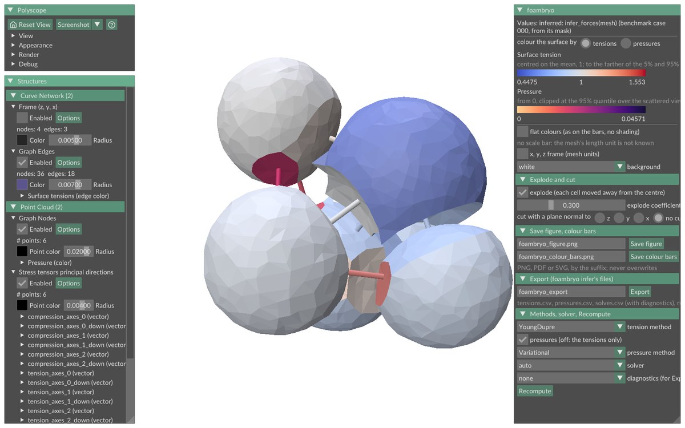

# foambryo

**foambryo** infers the relative surface tensions and cell pressures of foam-like cell aggregates (early embryos, tissues, organoids) from the geometry of their cells, in 3D and, since 0.8.0, in 2D. It starts from a segmentation mask, reconstructs its multimaterial mesh with [delaunay-watershed](https://github.com/VirtualEmbryo/delaunay-watershed), reads the contact angles and curvatures of the mesh, and inverts the Young-Dupré and Laplace laws. The same functions take a 3-D or a 2-D mask or mesh: the input decides the dimension. Everything 2D is provisional in 0.8.0.

* [Getting started](getting-started.md): installation and three quick starts (Python, command line, napari).
* [Methods note](methods-note.md): what foambryo computes, and how to read its results.
* User guide: [methods](user-guide/methods.md), [cropped tissues](user-guide/cropped-tissues.md), [anisotropic voxels](user-guide/anisotropic-voxels.md), [large tissues](user-guide/large-tissues.md), [seed ensembles](user-guide/seed-ensembles.md), [two-dimensional tissues](user-guide/two-dimensional-tissues.md), [viewers](user-guide/viewers.md).
* [Examples](examples/index.md), one page each: two on real 2D images of *C. elegans* embryos (with and without eggshell), the others runnable on generated data.
* [The command line](command_line_specification.md): every option, file, column, exit code and message.
* [API reference](api/index.md), generated from the docstrings.
* [Changelog](changelog.md) and [release notes](release-notes.md).

If you use foambryo, in 3D or in 2D, please cite both articles: Ichbiah S., Delbary F., McDougall A., Dumollard R., Turlier H. *Embryo mechanics cartography: inference of 3D force atlases from fluorescence microscopy.* Nature Methods **20**(12), 1989–1999 (2023), [doi:10.1038/s41592-023-02084-7](https://doi.org/10.1038/s41592-023-02084-7); and Yamamoto K., Ichbiah S., Perez M., Borrego-Pinto J., Delbary F., Goehring N. W., Northrop P., Turlier H., Charras G. *Spatiotemporal mapping of the contractile and adhesive forces sculpting early C. elegans embryos.* Developmental Cell **61**(6), 1273–1288.e4 (2026), [doi:10.1016/j.devcel.2026.04.013](https://doi.org/10.1016/j.devcel.2026.04.013).

foambryo is free software, under the GNU General Public License, version 3 or (at your option) any later version (`GPL-3.0-or-later`).
