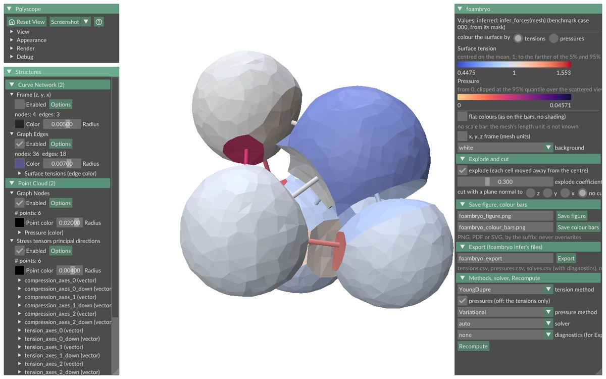
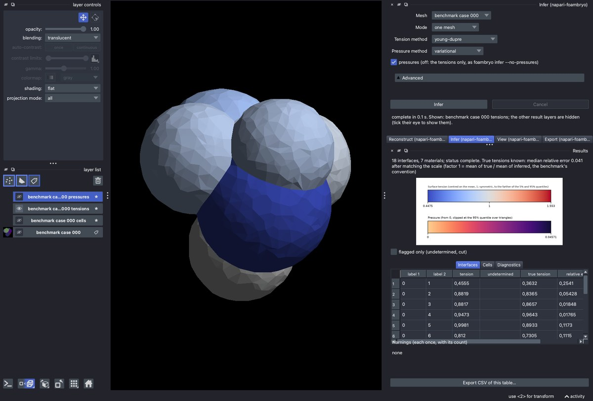

# Viewers: Polyscope and napari

Two viewers show the tensions and pressures on the tissue. Both compute nothing of their own: they draw what the library returns, coloured by the library's colour functions (`foambryo.colour_scales`), so a value has the same colour in both, and in the colour bars `save_colour_bars` and `foambryo view --colour-bars` write.

| Polyscope window (`foambryo[viewing]`) | napari plugin (`napari-foambryo`) |
|---|---|
|  |  |
| `foambryo view`, `view_mask`, `plot_force_inference` and the other `plot_*` functions | a Reconstruct, Infer, View, Export and Results dock in napari |

*Both: benchmark case 000 (a simulated 6-cell aggregate at equilibrium), reconstructed from its mask with the default reconstruction and inferred with `infer_forces`; the tensions on the surface (exploded by 0.3 in the Polyscope window), with the same colour bar, 0.4475 to 1.553 around the mean tension, 1.*

## The colours

* **Tensions**: matplotlib's `coolwarm`, light grey at the mean tension (`mean_tension`, 1 by default), blue below, red above. The range is centred on the mean and symmetric around it; its half-width is the farther of the `alpha` and `1 - alpha` quantiles from the mean (`alpha` is 0.05 by default), so both quantiles are inside it.
* **Pressures**: `magma` reversed, light for low pressures, trimmed to its 10–90 % range so that no cell is drawn black or near-white; from 0 to the `1 - alpha` quantile over the surface's triangles.
* **Undetermined values** (`nan`) are green (`#1b9e77`), outside both maps; in the Polyscope window an undetermined tension's interface is drawn as its outline, without fill.
* **Crop faces** are see-through glass with their edges drawn.
* Other quantities (a seed spread, a residual) keep `jet`.
* **Backgrounds**: white, light grey, dark grey and black (`foambryo.colour_scales.BACKGROUND_COLOURS`), or a custom colour, in both viewers: a colour that one background hides, another shows.

Colour bars without any window (matplotlib only, no display, no Polyscope):

```py
from foambryo.viewing import save_colour_bars

ranges = save_colour_bars(mesh, tensions, pressures, "colour_bars.png")   # returns the end values of each bar
```

## The Polyscope window

```py
from foambryo.viewing import plot_force_inference, plot_tension_inference, view_mask

plot_force_inference(mesh)                                  # infers with infer_forces' defaults, then opens the window
plot_force_inference(mesh, tensions, pressures, length_unit="um", save_figure="figure.png", show=False)
plot_tension_inference(mesh, seed_ensemble=result)          # a result of infer_tensions_over_seeds
view_mask(mask, spacing=(1.0, 0.5, 0.5))                    # starts from the mask: reconstructs and infers in the window
```

The window's panel ("foambryo") shows:

* which call produced the colours, and the colour bars of what is drawn; tensions are shown first when both tensions and pressures are inferred, and the panel switches between them;
* a length scale bar under the tissue when the mesh's unit is known (`length_unit`, or the unit a `.rec` file records), and an optional x, y, z frame;
* **Explode** (each cell moved away from the tissue's centre by a coefficient, followed live) and **Cut** (a plane normal to z, y or x);
* the background;
* **Save figure** (the view with its colour bars and scale bar; PNG, PDF or SVG) and **Save colour bars**, which never overwrite a file;
* **Export**: `foambryo infer`'s files for the values shown (`tensions.csv`, `pressures.csv`, `solves.csv` with diagnostics, `run.json`, `colour_bars.png`), asking before it replaces foambryo's files in a folder;
* a choice of tension method, pressure method (or none), solver and diagnostics, **Recompute**, and the `foambryo infer` command line that gives the same numbers.

Started from a mask (`foambryo view MASK --spacing DZ DY DX`, or `view_mask`), the window shows the mask first and reconstructs and infers it in separate processes, one mesh or a seed ensemble, each with its elapsed time, the [estimate](large-tissues.md) and a Cancel button.

`scalar_quantities=True` adds the mean and Gaussian curvatures (cotangent formula and angle defect), the vertex area and volume derivatives, the difference between the principal curvatures and the residual of the best sphere fit.

The Polyscope window needs a display. With `show=False`, `save_figure` writes the figure and closes the window; `save_colour_bars` needs neither a display nor Polyscope.

## The napari plugin

`pip install "napari[all]" napari-foambryo` (version 0.1.0, released with foambryo 0.7.0). Its docks reconstruct a Labels layer (whoever made it), infer the tensions and pressures or a seed ensemble, show the results with their colour bars and tables, and export the `foambryo` command's files with the command lines that reproduce them. Every number is one a public function of foambryo returns for the same mask and options; the plugin's tests check it bit for bit. See the plugin's README for its quick start and for *From a segmentation plugin to foambryo*.

Example: [the Polyscope viewer from Python](../examples/polyscope-viewer.md).
