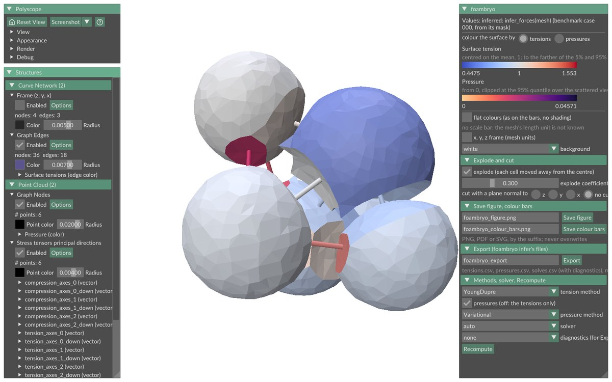
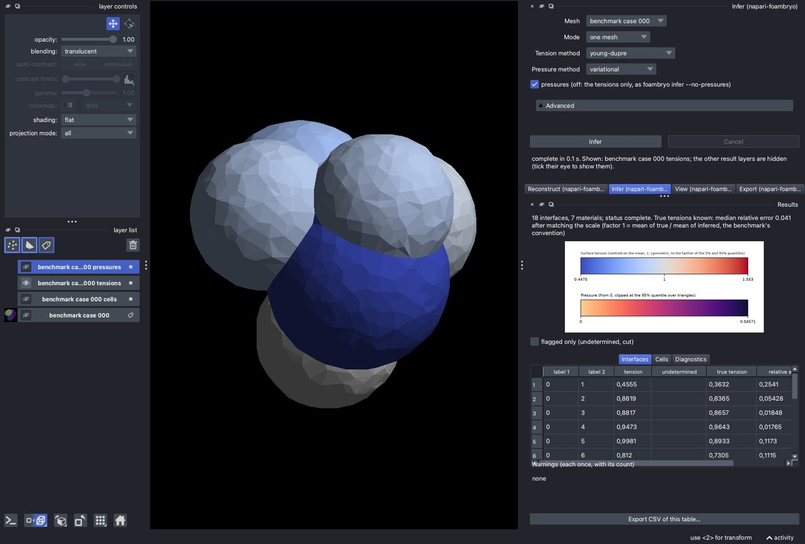

# Viewers: Polyscope and napari

Two viewers show the tensions and pressures on the tissue. Both compute nothing of their own: they draw what the library returns, coloured by the library's colour functions (`foambryo.colour_scales`), so a value has the same colour in both, and in the colour bars `save_colour_bars` and `foambryo view --colour-bars` write.

| Polyscope window (`foambryo[viewing]`) | napari plugin (`napari-foambryo`) |
|---|---|
|  |  |
| `foambryo view`, `view_mask`, `plot_force_inference` and the other `plot_*` functions | a Reconstruct, Infer, View, Export and Results dock in napari |

*Both: benchmark case 000 (a simulated 6-cell aggregate at equilibrium), reconstructed from its mask with the default reconstruction and inferred with `infer_forces`; the tensions on the surface, with the same colour scale centred on the mean tension, 1. Left: the figure `foambryo view MESH.rec --no-pressures --scattered 0.3 --figure FILE` writes, on dw3d 0.7.1's mesh (colour bar 0.4490 to 1.551), drawn the right way round (0.7.1's fix). Right: napari's window on dw3d 0.7.0's mesh (0.4475 to 1.553), in napari's default 3-D orientation, which shows the mirror image of the tissue (below, "Which way round").*

## The colours

* **Tensions**: matplotlib's `coolwarm`, light grey at the mean tension (`mean_tension`, 1 by default), blue below, red above. The range is centred on the mean and symmetric around it; its half-width is the farther of the `alpha` and `1 - alpha` quantiles from the mean (`alpha` is 0.05 by default), so both quantiles are inside it.
* **Pressures**: `magma` reversed, light for low pressures, trimmed to its 10–90 % range so that no cell is drawn black or near-white; from 0 to the `1 - alpha` quantile over the surface's triangles.
* **Undetermined values** (`nan`) are green (`#1b9e77`), outside both maps; in the Polyscope window an undetermined tension's interface is drawn as its outline, without fill.
* **Crop faces** are see-through glass with their edges drawn.
* Other quantities (a seed spread, a residual) keep `jet`.
* **Backgrounds**: white, light grey, dark grey and black (`foambryo.colour_scales.BACKGROUND_COLOURS`), or a custom colour, in both viewers: a colour that one background hides, another shows.

Colour bars without any window (matplotlib only, no display, no Polyscope):

```py
from foambryo.viewing import save_colour_bars

ranges = save_colour_bars(mesh, tensions, pressures, "colour_bars.png")   # returns the end values of each bar
```

## The Polyscope window

```py
from foambryo.viewing import plot_force_inference, plot_tension_inference, view_mask

plot_force_inference(mesh)                                  # infers with infer_forces' defaults, then opens the window
plot_force_inference(mesh, tensions, pressures, length_unit="um", save_figure="figure.png", show=False)
plot_tension_inference(mesh, seed_ensemble=result)          # a result of infer_tensions_over_seeds
view_mask(mask, spacing=(1.0, 0.5, 0.5))                    # starts from the mask: reconstructs and infers in the window
```

The window's panel ("foambryo") shows:

* which call produced the colours, and the colour bars of what is drawn; tensions are shown first when both tensions and pressures are inferred, and the panel switches between them;
* a length scale bar under the tissue when the mesh's unit is known (`length_unit`, or the unit a `.rec` file records), and an optional x, y, z frame along the mask's column, row and slice;
* **Explode** (each cell moved away from the tissue's centre by a coefficient, followed live) and **Cut** (a plane normal to z, y or x);
* the background;
* **Save figure** (the view with its colour bars and scale bar; PNG, PDF or SVG) and **Save colour bars**, which never overwrite a file;
* **Export**: `foambryo infer`'s files for the values shown (`tensions.csv`, `pressures.csv`, `solves.csv` with diagnostics, `run.json`, `colour_bars.png`), asking before it replaces foambryo's files in a folder;
* a choice of tension method, pressure method (or none), solver and diagnostics, **Recompute**, and the `foambryo infer` command line that gives the same numbers.

Started from a mask (`foambryo view MASK --spacing DZ DY DX`, or `view_mask`), the window shows the mask first and reconstructs and infers it in separate processes, one mesh or a seed ensemble, each with its elapsed time, the [estimate](large-tissues.md) and a Cancel button.

**Which way round.** The window draws the tissue as it is, not its mirror image. A mesh is stored in its mask's order, columns (z, y, x), and Polyscope reads the columns it is handed as its own (x, y, z); the window hands it the columns reversed, so that Polyscope's x, y and z are the mask's column, row and slice, and hands every triangle with two corners exchanged, so that it still faces the same side (exchanging two axes is a reflection, which turns every triangle over). Up to foambryo 0.7.0 the columns were handed as stored: every view, and every figure saved from the window, was the mirror image of the tissue, its left and right exchanged; no number was affected. The mesh is never changed: the files keep the mask's column order, (z, y, x), the `.rec` files `foambryo mesh` writes as well as the `.vtk` files delaunay-watershed-3d writes through meshio. A program that reads those columns as (x, y, z), as ParaView and MeshLab do, shows the mirror image of the tissue unless it exchanges columns 0 and 2. napari shows a mask and its mesh in the array's own order, (z, y, x): in its default 3-D camera orientation, `('towards', 'down', 'right')`, the picture is the mirror image in this sense (measured with napari 0.9.2 and the napari plugin 0.1.0 on a test mask that is not its own mirror image); `viewer.scene.camera.orientation = ('away', 'down', 'right')` shows the tissue the right way round, but napari then shades the plugin's surfaces darker.

`scalar_quantities=True` adds the mean and Gaussian curvatures (cotangent formula and angle defect), the vertex area and volume derivatives, the difference between the principal curvatures and the residual of the best sphere fit. On a 2-D mesh it adds the two curvatures of the interfaces, `|kappa|`: "Curvature (arc)", from each interface's fitted circle, and "Curvature (local)", at each vertex; the other quantities have no 2-D counterpart. Both are off until chosen in Polyscope's structure panel, and the colour bars still show the tensions and pressures.

With tensions and pressures, the window draws each cell's principal stresses at its centroid, in 3D and in 2D: the axes of its mean stress tensor (Batchelor's average of the pressure and the interface tensions over the cell), each scaled by its principal value and drawn both ways, compression in red and tension in teal. In 2D a cell cut by the image border has none. The stresses are built on the pressures, and both are measurements only when the cells are deformed by nothing but their own tensions and pressures: in an embryo confined by an eggshell, or cells on a substrate, the curvature of an interface is imposed by the confinement, Laplace's law does not give the pressures, and only the tensions may be read.

For such a tissue, `plot_force_inference(..., stress="deviatoric")` (on the command line `foambryo view MESH --stress deviatoric`; from a mask, `view_mask(..., stress="deviatoric")` or `foambryo view MASK --stress deviatoric`) draws each cell's deviatoric stress instead, `sigma - (tr sigma / d) I` with `d` = 2 or 3, as "Deviatoric stress principal directions". The pressure term is isotropic and drops out, so the deviatoric stress depends only on the tensions and the cells' shapes: it shows how anisotropic each cell's stress is and along which directions, and leaves out the isotropic part (whether the cell as a whole is compressed or stretched, which needs the pressure). It is the contribution of the cortical tensions to each cell's stress anisotropy. In a free tissue that is the anisotropic part of the cell's stress; in a confined embryo the shell's contact forces also act on the cells and are not in it, so there it is the cortical tensions' contribution only, not the cell's total stress anisotropy. It holds as such when the tensions are read near the junctions without assuming circular interfaces (in 2D, `angle_reading="chord"`, with `"fitted_tangent"` as a check; the default `"arc"` fits each interface to a circle, which assumes Laplace's law) and each interface's tension is uniform along it.

In that view the cells are not coloured by pressure (in 3D neither the surface's cell colours nor the graph's nodes; in 2D the cells are not filled), and the panel no longer offers to colour by pressure. Its colour bars, in the window, in a saved figure and in saved colour bars, are the tension bar and a bar titled "Deviatoric stress": red below 0 and teal from 0, the glyphs' two colours, from the smallest to the largest principal value over the cells drawn. Polyscope scales each vector quantity to its own longest vector, so glyph lengths drawn as different quantities are not comparable with each other; the bar gives the range of the principal values, not a length scale. The full stress's view is unchanged.

Where only the tensions read near the junctions hold (a confined tissue), see [two-dimensional tissues](two-dimensional-tissues.md) for which numbers to trust.

The Polyscope window needs a display. With `show=False`, `save_figure` writes the figure and closes the window; `save_colour_bars` needs neither a display nor Polyscope.

## The napari plugin

`pip install "napari[all]" napari-foambryo` (version 0.1.0, released with foambryo 0.7.0). Its docks reconstruct a Labels layer (whoever made it), infer the tensions and pressures or a seed ensemble, show the results with their colour bars and tables, and export the `foambryo` command's files with the command lines that reproduce them. Every number is one a public function of foambryo returns for the same mask and options; the plugin's tests check it bit for bit. See the plugin's README for its quick start and for *From a segmentation plugin to foambryo*.

Example: [the Polyscope viewer from Python](../examples/polyscope-viewer.md).
